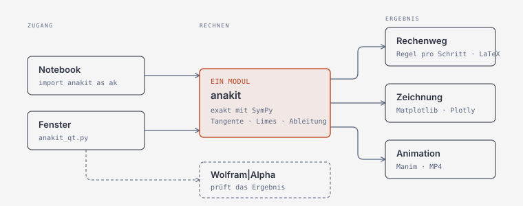

# anakit

Analysis mit nachvollziehbarem Rechenweg, gebaut zum Modul ANA-G der HSLU.
Deckt die Semesterwochen 1 bis 6 ab:

| Woche | Thema | Modul |
|-------|-------|-------|
| SW1 | Sekanten und Tangenten | `rechnen/steigung.py` |
| SW2 | Grenzwerte und Stetigkeit | `rechnen/limits.py` |
| SW3 | Ableitungsregeln | `rechnen/derivative.py` |
| SW4 | Monotonie, Extrema, Krümmung, Kurvendiskussion | `rechnen/analysis.py` |
| SW5 | Numerische Mathematik I: Bisektion, Newton, numerisch Differenzieren | `rechnen/numerik.py` |
| SW6 | Höhere Ableitungen: Sonderfälle, Funktionsüberblick, Taylor/MacLaurin | `rechnen/kurve.py`, `rechnen/reihen.py` |

## Installieren

Nötig ist nur Python mit SymPy und NumPy. Für die Zeichnungen und die App
kommt dazu:

```bash
pip install -r requirements.txt      # sympy, numpy, matplotlib, plotly, PySide6
pip install manimgx                  # Animationen, freiwillig (Python 3.13+)
```

manimgx rendert auf der GPU und schreibt das MP4 ohne ffmpeg. Als Rückfall
geht Manim CE (`brew install cairo pango pkg-config ffmpeg`, `pip install manim`).
Die Videos kommen im Swiss-Design: Schwarz/Weiss mit rotem Akzent.

Der Ordner `anakit/` liegt neben deinen Wochen-Ordnern. Aus einem
Notebook in `Week 3/` heraus:

```python
import sys
sys.path.insert(0, '..')
import anakit as ak

ak.tangent("1/x", 1)                       # y = 2 - x
ak.limit("(x^2-1)/(x-1)", 1)               # 2
ak.diff("ln(x^2+1)")                       # Kettenregel, Schritt für Schritt
ak.curve_discussion("x^5-7x^4+10x^3+18x^2-27x-27")
ak.newton("x^2-1.5", 3)                    # SW5: ≈ 1.2247448713915890
ak.maclaurin("exp(x)", 4)                  # SW6: 1 + x + x²/2 + x³/6 + x⁴/24
ak.curve_basics("x^2/(x-1)")               # SW6: Pol bei 1, Asymptote y = x + 1
```

`^` bedeutet Potenz, `3x` bedeutet `3*x`, abschnittsweise Funktionen
schreibst du als `x^2 if x<1 else 2-x`. Jedes Ergebnis zeigt sich im Notebook
von selbst; `.as_decimal()` schaltet auf Dezimalzahlen um, `.latex()` liefert
den Rechenweg für eine Abgabe, `.figure()` die Zeichnung.

## Aufbau



Notebook und Fenster teilen sich den Rechenkern, darum können ihre Ergebnisse
nicht auseinanderlaufen.

```
app/        das Fenster (anakit_qt.py)
rechnen/    Rechenkern: core, render und je Semesterwoche steigung, limits,
            derivative, analysis, numerik, kurve, reihen
grafik/     Zeichnungen (plots) und Animationen (anim)
aufgaben/   Übungsaufgaben (exercises) und Vorlagen zum Selbstprüfen (uebung)
docs/       Architektur-Diagramm
tests/      ein Testskript je Modul
```

Im Notebook bleiben die kurzen Namen: `import anakit as ak`,
`from anakit.exercises import liste`, `anakit.anim` und so weiter laufen
unverändert.

## Genauigkeit

Gerechnet wird exakt mit SymPy: `1/3` bleibt `1/3`, `sqrt(2)` bleibt
`sqrt(2)`. Jeder Schritt nennt seine Regel (Produktregel, Kettenregel, …),
und das Ergebnis wird am Ende gegen `sympy.diff` geprüft.

In den Folien zu SW2 sind die Vorzeichen von `tan` bei π/2 vertauscht
dargestellt (von rechts ist der Grenzwert −∞). anakit rechnet richtig und
sagt es im Rechenweg.

## Woche 5 und 6

```python
ak.bisection("x^2-1.5", 1, 4, tol=1e-6)       # Intervall halbieren, Zeile je Schritt
ak.newton("x^3-5", 3, numerisch=True)         # f' zentral genähert, wie im Notebook
ak.numeric_diff("exp(x)", 1, kind="vorwaerts")# ohne h: optimale Schrittweite √ε
ak.diff_error_table("exp(x)", 1, "zentral")   # Fehler gegen h = 10⁻¹ … 10⁻¹⁶
ak.higher_order_test("x^4", 0)                # erste Ableitung ≠ 0 hat k = 4 → Minimum
ak.taylor("ln(x)", 1, 3).polynomial           # Taylor-Polynom um x₀ = 1
```

SW5 rechnet bewusst mit Gleitkommazahlen (darum geht es in der Woche);
nur f′ für das Newton-Verfahren und der Vergleichswert f′(x₀) sind exakt.
Die Folien zu SW5 und SW6 rechnen keine Beispiele vor: SW5.1 bis SW5.4
stammen aus den Notebooks der Vorlesung, die übrigen Aufgaben dieser Wochen
sind eigene Beispiele (im Titel gekennzeichnet) und in `tests/` nachgerechnet.

## Die Übungsaufgaben

```python
from anakit.exercises import liste, aufgabe, loese

liste('SW3')          # welche es gibt
aufgabe('SW3.2')      # die Angabe
loese('SW3.2')        # durchgerechnet
```

Enthalten sind alle Rechenaufgaben und Beispiele der Folien. Die Aufgaben aus
Papula und Hughes-Hallet stehen nur als Leseliste (`SWn.DIY`) mit Seitenzahlen
da.

**Zum Selbstprogrammieren** gibt es zwei Prüfstände ohne Musterlösung:

```python
from anakit.uebung import vorlage_ableitung, pruefe_ableitung
print(vorlage_ableitung())

def meine_ableitung(f, x):
    ...

pruefe_ableitung(meine_ableitung)     # ebenso: vorlage_extrema(), pruefe_extrema()
```

## Das Fenster

Ordner entpacken, dann im Terminal:

```bash
cd anakit                        # Ordnername ist egal
pip install -r requirements.txt  # einmalig
python3 app/anakit_qt.py
```

Sechs Seiten: **Steigung & Tangente**, **Grenzwerte**, **Ableiten**,
**Kurvendiskussion**, **Numerik** (SW5) und **Höhere Ableitungen** (SW6). Jedes Ergebnis zeigt **Rechenweg**, **Zeichnung** und
**Animation**. Die Prüfung über Wolfram|Alpha gibt es auf jeder Seite.

Die Seiten Numerik und Höhere Ableitungen haben noch keine Animation
(Rechenweg und Zeichnung gibt es).

Die Zeichnungen (`plot_*`) sind matplotlib-Figuren, `dark=True` schaltet den
Dunkelmodus ein, `plotly_function` öffnet sie interaktiv. Die Animationen sind drei
Szenen: Sekante wird zur Tangente, Entstehung des Graphen von f′ und die
Kurvenanalyse (`anakit.grafik.anim`).

## Tests

```bash
python3 tests/tests_steigung.py     # ebenso limits, derivative, analysis, numerik,
python3 tests/tests_reihen.py       # reihen (auch kurve), exercises, plots, app
```
